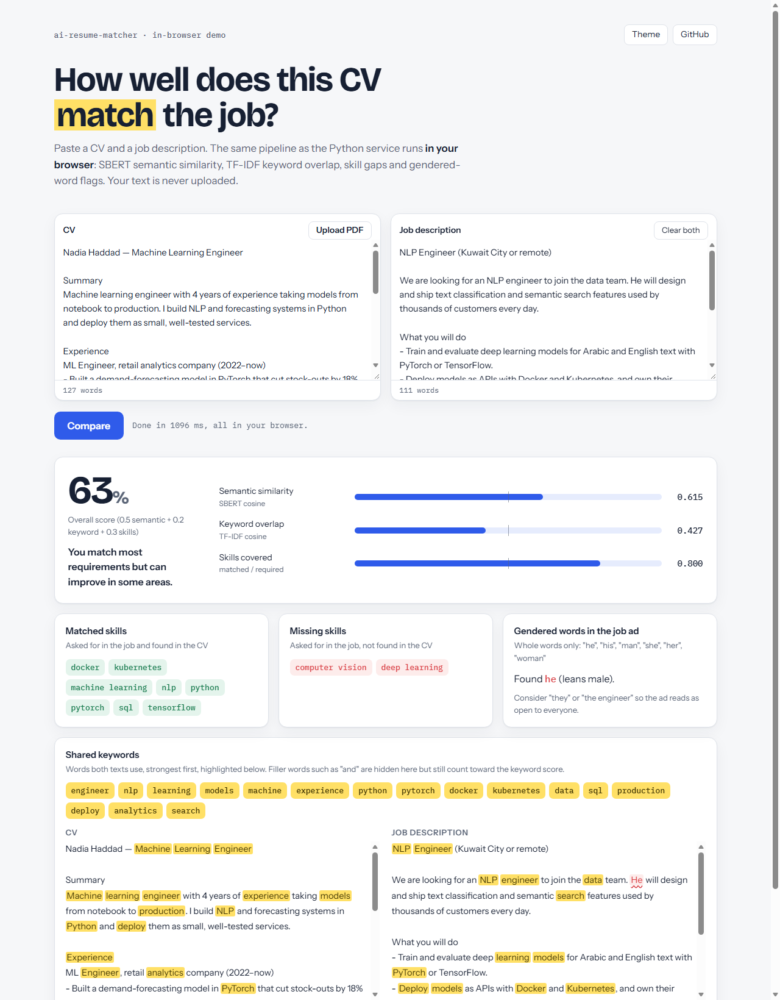
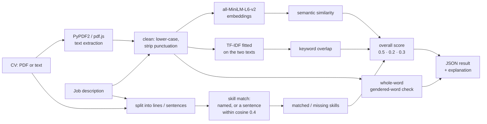

<div align="center">

# AI Resume Matcher

Score how well a CV fits a job description with sentence embeddings and TF-IDF, and see why: matched and missing skills, shared keywords, and gendered wording in the job ad.

**[▶ Live demo](https://nardy11.github.io/ai-resume-matcher/)** (runs in your browser, nothing is uploaded)

[](https://github.com/Nardy11/ai-resume-matcher/actions/workflows/ci.yml)
[](./LICENSE)
[](https://www.python.org/)

<a href="https://nardy11.github.io/ai-resume-matcher/"></a>

</div>

## ✨ What it does

Give it a CV (PDF or text) and a job description. It returns:

- **Semantic similarity**: cosine similarity of [all-MiniLM-L6-v2](https://huggingface.co/sentence-transformers/all-MiniLM-L6-v2) embeddings of the two texts. It rewards related meaning even when the wording differs.
- **Keyword overlap**: TF-IDF cosine similarity of the two texts. It rewards the same words.
- **Skill gap**: which of 16 tracked skills (Python, Docker, SQL, PyTorch, NLP, ...) the job asks for, which the CV covers and which are missing.
- **An overall score**: `0.5 × semantic + 0.2 × keyword + 0.3 × share of required skills covered`, with a one-line explanation.
- **Gendered-word flags**: whole-word check of the job description for "he", "his", "man", "she", "her", "woman".

It ships three ways, all running the same logic:

| | What | Where |
|---|---|---|
| API | FastAPI service, `POST /analyze` | [`app/`](app) |
| Browser demo | Static page, the model runs in the browser with transformers.js | [`demo/`](demo), deployed to GitHub Pages |
| Gradio app | Ready-to-deploy Hugging Face Space wrapping the Python code | [`space/`](space) |

The browser demo is a port of [`app/analysis.py`](app/analysis.py) to JavaScript ([`demo/matcher.js`](demo/matcher.js)). Run on the 20 evaluation pairs below, it gives the same skills, bias flags and explanations as the Python service on every pair, and scores within 3 × 10⁻⁷ of it.

## Pipeline



## Results

[`eval/evaluate.py`](eval/evaluate.py) scores 20 hand-written CV / job-description pairs from [`eval/pairs.json`](eval/pairs.json): 10 labelled *match*, 10 *no-match*. Four of them are harder on purpose: a career changer with a statistics thesis and a five-line CV (both *match*), and a frontend developer applying for a Python backend role and a data analyst applying for an MLOps role (both *no-match*). The threshold of 0.5 was fixed before running, not tuned.

| Score | Mean (match) | Mean (no-match) | Lowest match | Highest no-match | ROC AUC | Accuracy at 0.5 |
|---|---|---|---|---|---|---|
| Semantic (SBERT) | 0.751 | 0.109 | 0.432 | 0.269 | 1.00 | 0.95 |
| Keyword (TF-IDF) | 0.346 | 0.124 | 0.162 | 0.292 | 0.95 | 0.50 |
| Overall | 0.646 | 0.085 | 0.417 | 0.220 | 1.00 | 0.95 |

What this shows:

- Semantic similarity carries the signal. Every match scores above every no-match (AUC 1.00); the one error at 0.5 is the career changer (0.43 semantic, 0.42 overall), whose CV describes the right work in different words.
- TF-IDF alone ranks the pairs reasonably (AUC 0.95) but its scores are low across the board, so a 0.5 cut-off labels everything *no-match* (accuracy 0.50, the base rate). It is a supporting signal, not a classifier.
- 20 synthetic pairs is a sanity check, not a benchmark. The negatives are mostly different professions, which is easy; real screening is about ranking similar candidates, and these numbers say little about that.

Reproduce with `python eval/evaluate.py` (writes [`eval/results.json`](eval/results.json)).

## Model card

**Model.** [`sentence-transformers/all-MiniLM-L6-v2`](https://huggingface.co/sentence-transformers/all-MiniLM-L6-v2), a 22M-parameter sentence encoder (384 dimensions, mean pooling, inputs truncated at 256 word pieces). It is used as-is; nothing here is fine-tuned. The browser demo uses the ONNX export [`Xenova/all-MiniLM-L6-v2`](https://huggingface.co/Xenova/all-MiniLM-L6-v2) at full precision. TF-IDF is scikit-learn's `TfidfVectorizer` with default settings, fitted on the two texts being compared.

**Data.** No training data. The skill list is 16 hand-picked terms in [`app/skills.json`](app/skills.json). The evaluation set is 20 synthetic English pairs written for this project.

**Intended use.** A second opinion for a job seeker tailoring a CV, or for a recruiter skimming many CVs who wants to see which skills a CV seems to lack and whether a job ad uses gendered wording. A human reads the result and decides.

**Not intended for** ranking, filtering or rejecting candidates automatically, or any decision about a person without human review.

**Limitations.**
- Only the first 256 word pieces of each text (roughly 200 English words) shape the semantic score. A long CV is judged on its opening.
- Skills are limited to the 16 on the list. Matching is semantic per sentence, so it can over-reach: in the demo's example, a CV that mentions PyTorch but never TensorFlow is credited with TensorFlow.
- TF-IDF has no stop-word list and is fitted on only two documents, so common words count and rare synonyms do not.
- English only in practice. The model was trained mostly on English; Arabic or mixed-language CVs score unreliably.
- PDF extraction needs a text layer. Scanned CVs return no text.
- The overall weights (0.5 / 0.2 / 0.3) were set by hand, not learned.

**Bias notes.**
- The gendered-word check is a six-word list matched on whole words (an earlier version matched substrings, so "the" counted as "he"; fixed and covered by tests). It does not catch gender-coded language ("rockstar", "dominant", "nurturing"), and it says nothing about bias in the scores themselves.
- Sentence embeddings inherit associations from their web training data. A CV's wording, which varies with background, schooling and first language, moves the semantic score. Two equally qualified people can score differently because they describe their work differently, as the career-changer pair in the results shows.
- Names, gender, age and nationality in a CV are not removed before scoring. Strip them first if you use this on real CVs.

## API

Start the service (see below), then:

```bash
curl -X POST http://127.0.0.1:8000/analyze \
  -F "cv=@tests/sample_cv.pdf" \
  -F "job_description=Python backend engineer. He will build APIs with FastAPI and Docker."
```

Response for the sample CV in `tests/` (scores rounded here to three decimals):

```json
{
  "sbert_score": 0.439,
  "tfidf_score": 0.168,
  "advanced_score": 0.403,
  "matched_skills": ["python"],
  "missing_skills": ["docker"],
  "bias": {"male_bias": 1, "female_bias": 0, "dominant": "male", "flagged_words": ["he"]},
  "explanation": "Your CV is missing several key skills for this role."
}
```

Interactive docs are at `http://127.0.0.1:8000/docs`.

## Run it yourself

With a virtual environment (Python 3.11+):

```bash
python -m venv .venv
source .venv/bin/activate          # Windows: .venv\Scripts\activate
pip install -r requirements.txt
python -m pytest                   # 22 tests
uvicorn app.main:app --reload      # http://127.0.0.1:8000/docs
python eval/evaluate.py            # the Results table
```

With Docker:

```bash
docker build -t ai-resume-matcher .
docker run -p 8000:8000 ai-resume-matcher
```

The browser demo is plain static files. To preview it locally:

```bash
mkdir -p _site && cp -r demo/. _site/ && cp app/skills.json _site/
python -m http.server -d _site 8080   # http://localhost:8080
```

## Deploy the Hugging Face Space

[`space/`](space) holds a Gradio app that calls the same Python code as the API. To publish it:

1. Create a free account at [huggingface.co](https://huggingface.co/join), then **New → Space**: name it `ai-resume-matcher`, SDK **Gradio**, hardware **CPU basic** (free).
2. Clone the empty Space and copy the files in. The Python package goes in as `matcher/`:

   ```bash
   git clone https://huggingface.co/spaces/<your-username>/ai-resume-matcher hf-space
   cp space/app.py space/requirements.txt space/README.md hf-space/
   cp -r app hf-space/matcher
   rm -rf hf-space/matcher/__pycache__
   cd hf-space
   git add . && git commit -m "Deploy AI Resume Matcher" && git push
   ```

   When git asks for a password, use an access token with write scope from **Settings → Access Tokens**.
3. The Space builds in a few minutes. Add its URL to this README next to the live demo.

To try the Gradio app locally first: `pip install gradio==6.31.0 && python space/app.py`.

## Project layout

```
app/            FastAPI service: analysis.py (pipeline), model.py, bias.py, skills.json
demo/           In-browser demo (GitHub Pages): index.html, app.js, matcher.js
space/          Hugging Face Space (Gradio)
eval/           Evaluation pairs, script and results
tests/          pytest suite (API, model, skills, bias, logging)
eda/            Exploration notebook from the course
```

## Credits

Started as the capstone for the [IBM AI Workflow specialization](https://www.coursera.org/specializations/ibm-ai-workflow) on Coursera, then extended with the evaluation, the browser demo and the Space. Sentence embeddings by [Sentence-Transformers](https://www.sbert.net/); in-browser inference by [Transformers.js](https://huggingface.co/docs/transformers.js); PDF reading by [PyPDF2](https://pypi.org/project/PyPDF2/) and [PDF.js](https://mozilla.github.io/pdf.js/).

## License

MIT, see [LICENSE](./LICENSE).
